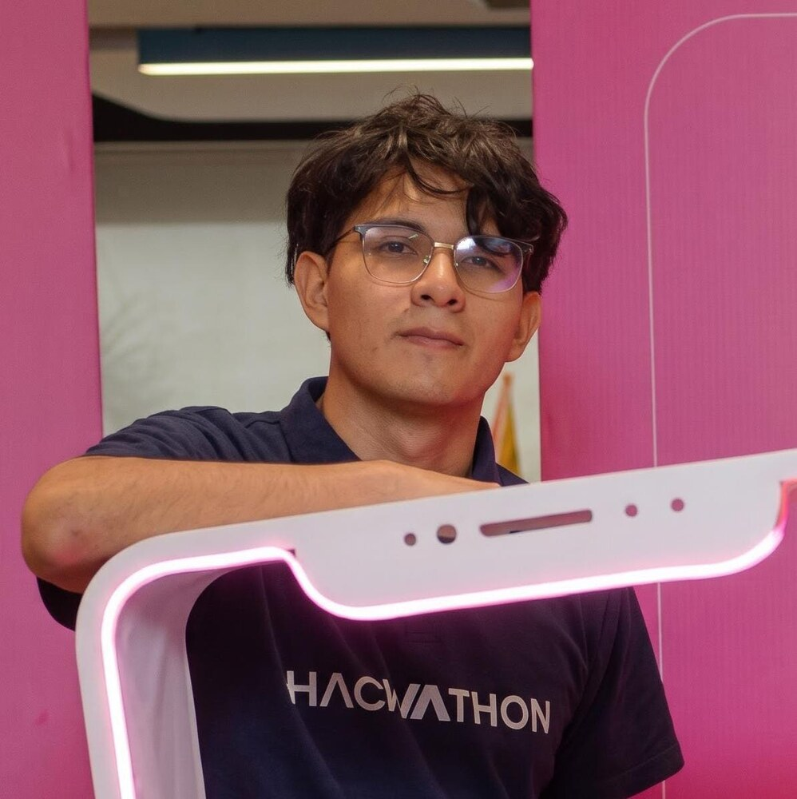

# Hola, soy Joshua Mero 👋

Soy estudiante de Computación en ESPOL, presidente del club NIoT y ayudante de docencia. Me interesa construir soluciones que conecten desarrollo web y móvil, Internet de las Cosas e inteligencia artificial para resolver problemas reales.

🌐 **Portafolio desplegado:** [josh-gavi.github.io/josh-gavi](https://josh-gavi.github.io/josh-gavi/)

## Sobre mí

- Desarrollo aplicaciones web y móviles con enfoque en experiencias claras y funcionales.
- Trabajo con proyectos de IoT utilizando ESP32 y MicroPython.
- Me interesan el análisis de algoritmos, la ciencia de datos y el software de código abierto.
- Disfruto colaborar en equipos universitarios y documentar el proceso de desarrollo.

## Experiencia académica

### Ayudante de docencia · ESPOL

Apoyo a estudiantes en la comprensión de conceptos, resolución de ejercicios y preparación académica en **Álgebra Lineal** y **Matemáticas Discretas**, promoviendo explicaciones paso a paso y un aprendizaje accesible.

## Tecnologías y aplicación

| Tecnologías | Aplicación en mis proyectos |
| --- | --- |
| HTML, CSS y JavaScript | Estructura, diseño adaptable e interacciones del sitio del Museo Presley Norton y de este portafolio. |
| React, Vite y Material UI | Construcción de interfaces web por componentes y elementos visuales reutilizables. |
| TypeScript | Tipado de componentes, propiedades y datos para reducir errores en Findyp y Bizly. |
| React Native y Expo | Desarrollo y prueba de interfaces móviles multiplataforma. |
| Supabase | Autenticación, base de datos y almacenamiento de información e imágenes. |
| Git, GitHub y GitHub Pages | Control de versiones, colaboración, documentación y despliegue del portafolio. |
| Python y MicroPython | Lógica, automatización, análisis de datos y programación de prototipos con ESP32. |
| ESP32 e IoT | Integración de sensores, actuadores y comunicaciones en sistemas embebidos. |

## Proyectos destacados

### Findyp

Aplicación multiplataforma para publicar, buscar y recuperar objetos perdidos dentro de comunidades universitarias. Incluye autenticación, reportes, imágenes, filtros y mapas.

**Tecnologías:** React Native, Expo, TypeScript y Supabase.  
[Ver repositorio](https://github.com/Sam-ai06/Poli-Lost-and-Found)

### Museo Presley Norton

Sitio web creado para fomentar la interacción de la comunidad con actividades culturales como las que se realizan en el Museo Presley Norton.

**Tecnologías:** HTML, CSS y JavaScript.  
[Ver repositorio](https://github.com/josh-gavi/MuseoPresleyNorton)

### Bizly

Aplicación móvil y web pensada para estudiantes emprendedores, con una base personalizable para organizar y presentar sus negocios o servicios.

**Tecnologías:** TypeScript, desarrollo web y desarrollo móvil.  
[Ver repositorio privado](https://github.com/josh-gavi/Bizly)

## Intereses actuales

- Desarrollo de aplicaciones web y móviles.
- Internet de las Cosas y sistemas embebidos.
- Inteligencia artificial y ciencia de datos.
- Diseño y análisis de algoritmos.
- Proyectos universitarios de código abierto.

## Contacto profesional

- Correo institucional: [ariegavi@espol.edu.ec](mailto:ariegavi@espol.edu.ec)
- GitHub: [josh-gavi](https://github.com/josh-gavi)

